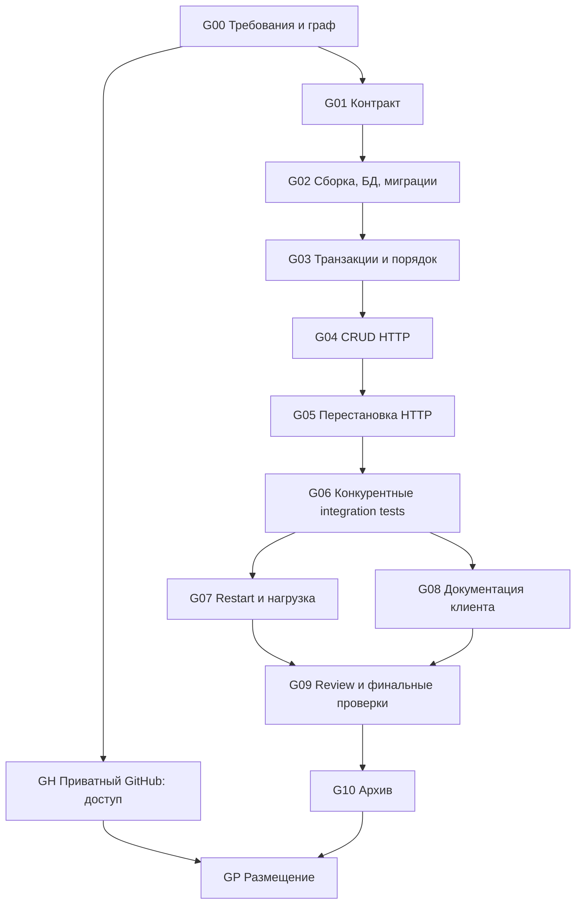

# UF3: Graph Spec r2

Дата: 2026-10-14. Workflow ID: UF3-TEAM-TASKS-20261014.
Режим: Graph. Владелец интеграции: root.
Текущий объём: локальная реализация, коммиты, проверки и архив. Автор разрешил продолжение после запуска Docker; создание и размещение GitHub выполняет сам автор.
Решения автора: новый проект; имя `team-tasks-api`; приватный GitHub; план утверждён для локального продолжения.
Компания по имени PDF не установлена; план не привязан к другой вакансии в workspace.

## Цель и критерий завершения

План завершён, когда каждое обязательное и дополнительное требование имеет узел, будущий коммит и наблюдаемую проверку, опубликован граф с зависимостями и явно отделены требования PDF от проектных решений.

Будущая реализация завершена только после прохождения unit, HTTP/DB integration, конкурентных и restart-проверок; наличия воспроизводимой инструкции, клиентской документации, отчёта нагрузочного запуска и чистого архива. GitHub размещение проверяется отдельно и не заменяет runtime-проверки.

PDF даёт ориентир 6 часов и максимум 8 часов. Это ограничение задания, а не уже измеренное время работы. На странице 2 Gradle и отказ от JPA повторены как бонусы; обязательность сохраняется по странице 1. Все бонусы включены в будущий план по запросу автора, хотя документ их не требует одновременно.

## Матрица требований

| ID | Требование источника | Узлы / коммиты | Приёмочная проверка |
|---|---|---|---|
| R01 | CRUD: create, read, read all, update, delete | G01,G04 / C1,C4 | HTTP-сценарий всех пяти операций, 404 после удаления |
| R02 | Обязательные teamId, name, description, priority | G01,G02,G04 / C1,C2,C4 | В сохранённой задаче все поля; отсутствующие входные поля дают 400; priority генерируется сервером |
| R03 | Обычный update меняет только name, description | G01,G04,G06 / C1,C4,C6 | teamId/priority в PATCH отвергаются; записи не меняются |
| R04 | При создании max(priority)+1; первая задача =1 | G03,G04,G06 / C3,C4,C6 | Пустая и непустая команды; одновременные POST |
| R05 | Нет одинаковых priority внутри команды | G02,G03,G05,G06 / C2,C3,C5,C6 | UNIQUE в БД; конкурентные операции; одинаковые номера в разных командах допустимы |
| R06 | Priority каждой команды строго 1..N без пропусков | G03,G05,G06 / C3,C5,C6 | Удаление первой/средней/последней задачи; перемещения вверх/вниз; проверка всего упорядоченного списка |
| R07 | Отдельный endpoint обновления priority | G01,G05 / C1,C5 | Перемещение в начало/середину/конец и на прежнее место; выход за 1..N даёт 400 |
| R08 | Перезапуск API не теряет данные | G02,G07 / C2,C7 | Создать, остановить API, запустить, сравнить id и поля |
| R09 | Полная инструкция запуска и использования; логика, нагрузка, restart | G07,G08 / C7,C8 | Другой человек выполняет команды из README без скрытых шагов |
| R10 | Spring Boot, Kotlin, Gradle, без JPA | G02,G08 / C2,C8 | Сборка wrapper; инспекция dependency tree, JDBC persistence |
| B01 | Gradle | G02 / C2 | Совпадает с R10 |
| B02 | REST: глаголы и маршруты | G01,G04,G05 / C1,C4,C5 | Контракт и HTTP-коды согласованы с реализацией |
| B03 | Архитектурные шаблоны хорошего API | G01,G03,G04 / C1,C3,C4 | Controller -> Service -> Repository; транзакции в service; HTTP не просачивается в persistence |
| B04 | Ошибки и валидация | G01,G04,G05 / C1,C4,C5 | Некорректный JSON, поля, диапазоны, неизвестный id; единый формат ошибок |
| B05 | Без JPA | G02 / C2 | Совпадает с R10 |
| B06 | Одна команда запуска, разные платформы | G02,G07 / C2,C7 | `docker compose up --build`; Linux CI, Windows локально при доступном Docker |
| B07 | Читаемость, комментарии | G09 / C9 | Review; комментарии объясняют блокировку/перестановку, без пересказа кода |
| B08 | Unit tests | G03,G05,G06 / C3,C5,C6 | Табличные тесты перестановки и удаления, негативные границы |
| B09 | Нагрузочные тесты | G07 / C7 | Сохранённые команда, конфигурация, среда, throughput, latency, ошибки и итоговый инвариант |
| B10 | Документация клиента | G01,G08 / C1,C8 | OpenAPI и curl-примеры согласованы с контрактом |
| D01 | Решение сдать архивом через HR | G10 / C9 | Архив запускается после распаковки; отправка HR вне текущего объёма |

## Предлагаемый контракт и принятые допущения

Это проектные решения, а не дополнительные требования работодателя. Пересмотреть до начала реализации при появлении уточнений.

- `id`: UUID; `teamId`: положительный integer, представляется Long. Отдельный CRUD команд и аутентификация не требуются. API для локальной проверки; публичный production deployment не планируется.
- `name`: непустая строка до 200 символов; `description`: обязательная непустая строка до 10000 символов. Конкретные лимиты выбраны для предсказуемой валидации.
- `POST /tasks` принимает teamId, name, description; возвращает 201, Location и полную задачу. Входной priority отвергается: обязательность поля относится к сущности, значение рассчитывает сервер.
- `GET /tasks/{id}`: 200 или 404. `GET /tasks?teamId=...`: все задачи команды по priority; без фильтра все задачи по teamId, priority. Пагинация вне задания.
- `PATCH /tasks/{id}`: минимум одно из name/description; неизвестные поля, teamId, priority, null и пустой объект дают 400. Не переданное поле сохраняется. Ответ 200.
- `DELETE /tasks/{id}`: 204; неизвестный id даёт 404; оставшиеся задачи уплотняются.
- `PATCH /tasks/{id}/priority`, тело `{ "priority": 2 }`: 200 с обновлённой задачей; диапазон строго 1..N, без автоматического clamp. Перемещение сдвигает соседей, сохраняет их относительный порядок. No-op разрешён.
- Ошибки: единый JSON с status, code, message, fieldErrors; 400 для входа, 404 для отсутствия задачи, 503 для исчерпанного ограниченного retry при временной DB-конкуренции. Никаких SQL/stack traces в ответе.
- Нет гарантии идемпотентности POST: повтор после неизвестного исхода может создать вторую задачу. Задание не требует idempotency keys.

Пример: `[A:1,B:2,C:3,D:4]`, перенос D на 2 -> `[A:1,D:2,B:3,C:4]`, удаление B -> `[A:1,D:2,C:3]`.

## Предлагаемая архитектура и инварианты

Kotlin + Spring Boot + Gradle wrapper + Spring JDBC + PostgreSQL + миграции Flyway. Точные совместимые версии и JDK проверяются по официальной документации в G02; план не утверждает, что они уже выбраны или проверены.

Таблицы: `team_locks(team_id PK)` и `tasks(id PK, team_id FK, name NOT NULL, description NOT NULL, priority NOT NULL CHECK(priority > 0))`. Для `(team_id, priority)` использовать `UNIQUE DEFERRABLE INITIALLY DEFERRED`.

Каждая операция, меняющая множество или порядок задач, выполняется в одной транзакции: создать при необходимости строку team_locks через INSERT ON CONFLICT DO NOTHING; взять её SELECT FOR UPDATE; после блокировки читать актуальные задачи и вычислять изменения; записать изменения; commit. Все write-пути используют одну блокировку, включая обычный PATCH, чтобы избежать гонок с DELETE. Для операций по id сначала определить teamId, взять блокировку и повторно проверить наличие задачи. teamId неизменяем. Строки team_locks сохраняются и после удаления последней задачи.

Создание добавляет N+1. Удаление убирает запись и уменьшает priority всех последующих. Перенос p -> q: при q
p сдвигает [p+1,q] на -1; целевой задаче ставит q. Внутри транзакции deferred unique может временно допускать конфликт; другие транзакции не видят незакоммиченные значения. На commit не допускается дубликатов. Если фраза «в любой момент» означает запрет даже внутренних промежуточных состояний, это требует отдельного уточнения; наблюдаемый API-инвариант сохраняется.

READ COMMITTED достаточно при едином протоколе блокировки; чтение списка должно быть одним SELECT, чтобы получить согласованный снимок. UNIQUE и CHECK страхуют локальные ограничения, но непрерывность 1..N обеспечивается алгоритмом и тестами. Прямые SQL-изменения вне сервиса не покрыты. Блокировка должна работать между несколькими экземплярами API, поэтому JVM-lock недостаточен.

Docker Compose сохраняет PostgreSQL в named volume. Restart API и обычный compose down/up сохраняют данные; `down -v` удаляет volume и не является restart-тестом. Никаких in-memory хранилищ в основном профиле.

## Граф исполнения будущей реализации

Начало локальной реализации разрешено сообщением автора «можешь продолжать». r2 исключает GH/GP из обязательного completion по явному решению автора работать локально. Остальные зависимости и проверки сохранены.

| Узел | Владелец / owned targets | Вход | Действие | Evidence для succeeded |
|---|---|---|---|---|
| G00 | root / docs/graph-* | PDF и решения автора | Матрица, граф, коммиты | Каждое R/B/D покрыто; текущий результат |
| G01 | root / docs/api.yaml, docs/decisions.md | G00 + поручение реализации | Зафиксировать API, границы и invariants | Разбор всех примеров и негативных случаев; C1 |
| G02 | implementer / build*, gradle/, Dockerfile, compose.yaml, application*, db/migration/ | G01 | Проверить версии, bootstrap, JDBC schema | Wrapper build, миграция на пустой БД, compose health; C2 |
| G03 | implementer / domain/, repository/, service/ | G02 | Единый transactional write protocol | Unit и DB-тест create/delete/locks; C3 |
| G04 | implementer / api/, CRUD tests | G03,G01 | CRUD, валидация, error mapping | HTTP CRUD и запрет mutable teamId/priority; C4 |
| G05 | implementer / priority service/API и tests | G04 | Отдельное перемещение | Unit+HTTP всех направлений, no-op, границ; C5 |
| G06 | test owner / integration tests | G05 | Конкурентные операции и реальные DB constraints | N последовательных priority, unique ids, корректные ошибки; C6 |
| G07 | runtime owner / scripts/, load/, runtime report | G06 | Restart, нагрузка, запуск Compose | Реальный отчёт со средой и результатами; C7 |
| G08 | docs owner / README.md, docs/api.yaml, client examples | G06 | Закончить инструкции и OpenAPI | Выполненные curl-примеры, чистый старт по README; C8 |
| G09 | root/reviewer / review record, исправления последовательно через владельца | G07 AND G08 | Review и финальный build/test | Все обязательные проверки зелёные; замечания закрыты; C9 |
| G10 | root / output archive вне tracked sources | G09 | Чистый архив | Распаковка, сборка, состав без секретов/DB volumes/build cache |
| GH | root / GitHub access | G00 | Восстановить авторизацию без раскрытия токена | Доступ к созданию IldarRash/team-tasks-api подтверждён |
| GP | GitHub owner / remote repository | GH AND G10 | Создать private repo и разместить историю | private=true, корректный remote и SHA; репозиторий доступен автору |

Названия владельцев обозначают ответственности, а не уже запущенных агентов. Делегировать только при необходимости, отдельным brief с objective, owned targets, входами, authority, ожидаемым evidence и return condition. Общие файлы и сервис порядка редактируются последовательно.

### Состояния, joins, guards и recovery

- Допустимые состояния: pending, ready, running, awaiting_approval, succeeded, skipped, failed, blocked, cancelled. Узел ready только после succeeded всех обязательных родителей и наличия входов.
- G00-G10 succeeded. GH/GP skipped по решению автора размещать репозиторий самостоятельно. Evidence: docs/verification.md и docs/verification-results/.
- Fan-out G06 -> G07/G08 возможен при отсутствии общих правок; G09 использует AND-join. GP требует оба GH/G10, но доступ GitHub не блокирует локальную реализацию.
- Guard false для отсутствующего Docker: G07 blocked с точной причиной, G08 может продолжить описывать инструкции, но не выдавать их за проверенные. Нагрузочный и restart evidence обязательны для будущего completion.
- Если transient DB failure: максимум 2 повторные транзакции после первой, только для доказанного rollback (deadlock/serialization), затем 503. Не повторять POST после неизвестного исхода commit. Конкретные backoff/SQLSTATE фиксируются и тестируются в G03.
- При failed проверке: один диагностический проход, ограниченное исправление у владельца, повтор только затронутого check. До 2 циклов на одну причину; затем blocked с evidence и следующим действием. Новый цикл только при новой проверяемой гипотезе.
- Независимый review не разрешает расширять scope. Значимые изменения узлов/edges/joins/guards/recovery/completion -> r2 и подтверждение автора перед исполнением изменённого графа.
- Protected gates: публикация наружу, merge, deployment, отправка HR и удаление данных требуют отдельного решения с конкретной целью. Создание и размещение репозитория автор выполняет самостоятельно; remote-действия root исключены текущим уточнением. Выполнение пользовательского login производится без извлечения/печати секретов.
- Deadlock объявляется, если нет ready узлов, допустимого recovery и разрешённого внешнего действия. Завершение локального решения и GitHub handoff учитываются отдельно.

## Будущие коммиты

Одна история для одного решения. Это план, реальные SHA ещё не созданы. Каждый коммит должен собираться; новые tests добавляются с соответствующей функциональностью.

| Коммит | Subject | Состав / результат | Бюджет реализации |
|---|---|---|---|
| C1 | `docs: define task API contract and invariants` | OpenAPI, decisions, примеры, требования | 25 мин |
| C2 | `build: bootstrap Kotlin service with PostgreSQL` | Gradle wrapper, Boot/JDBC/Flyway, Compose, schema | 45 мин |
| C3 | `feat: serialize task ordering by team` | Repository, locks, create/delete algorithms, focused tests | 55 мин |
| C4 | `feat: expose validated task CRUD endpoints` | Controllers, DTO, validation, errors, HTTP tests | 45 мин |
| C5 | `feat: support atomic task priority changes` | Отдельный endpoint, shifts, boundary tests | 40 мин |
| C6 | `test: verify task invariants under concurrent requests` | Testcontainers, competing writes, multiple API/service instances | 45 мин |
| C7 | `test: add restart and load verification` | Restart scenario, load script, фактический отчёт | 40 мин |
| C8 | `docs: document local startup and API usage` | README, curl, OpenAPI, limitations | 35 мин |
| C9 | `chore: finalize verification and delivery packaging` | Review fixes при наличии, archive script, checklist | 30 мин |

Итого ориентир 6 часов; до 2 часов резерва на окружение и исправления. Это оценка, не обещание и не таймер. Если замечаний нет, C9 не создаётся пустым ради количества; archive/checklist входят в C8. Архив и нагрузочные результаты нельзя подменять сгенерированным шаблоном успешного отчёта.

## Минимальная проверка G06/G07

1. На реальном PostgreSQL: пустая команда; 20 последовательных созданий; удаление всех позиций; перемещения 1->N, N->1, на прежнее место; rollback после ошибки.
2. Барьерный старт одновременных POST одной команды: все успешные задачи уникальны, итоговые priority ровно 1..N. Отдельные команды не смешиваются.
3. Смешанный POST/DELETE/reorder: ожидаемые 404 при конкуренции допустимы; неожиданные 500/дубликаты/пропуски недопустимы. Два независимых соединения/экземпляра исключают случайную защиту JVM-lock.
4. Во время записи читать список одним SELECT: каждый полученный снимок удовлетворяет инварианту. Повторить сценарий с несколькими экземплярами API при возможности.
5. Restart: сохранить id/поля, перезапустить API с той же БД, сравнить. Дополнительно compose down/up без -v подтверждает volume persistence.
6. Load: фиксированная среда, 30 секунд разогрева + 60 секунд нагрузки, 20 виртуальных пользователей; отдельно hot team и несколько команд. Сохранить latency p50/p95/p99, throughput, HTTP/DB ошибки и финальную проверку 1..N. Без произвольного SLA: threshold корректности zero unexpected errors; производительность описывается измерениями.
7. Сборка и tests из чистого checkout/архива. CI Linux; Windows проверяется реально или маркируется непроверенным. Статическая проверка конфигов не считается runtime evidence.

## Открытые вопросы и вне объёма

- GitHub auth восстановить перед размещением. Репозиторий не создан текущим этапом.
- Проверено: JDK17, Gradle8.13, Kotlin2.1.20, Spring Boot3.5.7, PostgreSQL16.14; Docker доступен. Load runner: Python standard library. Результаты: docs/verification.md.
- Принятые допущения о непустом description, типе teamId, PATCH и перемещении диапазона явно записаны; при возможности их можно уточнить у работодателя. Обращение через HR не выполняется автоматически.
- GitLab, UI, team CRUD, authentication, cloud deployment, Kafka, метрики production и idempotency keys не входят в план задания.

## Итог исполнения r2

Локальная реализация и все обязательные проверки завершены. Реальная история содержит C1-C9. Нагрузочные измерения, restart/volume persistence и сборка из распакованного архива подтверждены в docs/verification.md. Root выполнял bounded review без заявления об изолированном независимом reviewer. GitHub/GitLab не изменялись.
